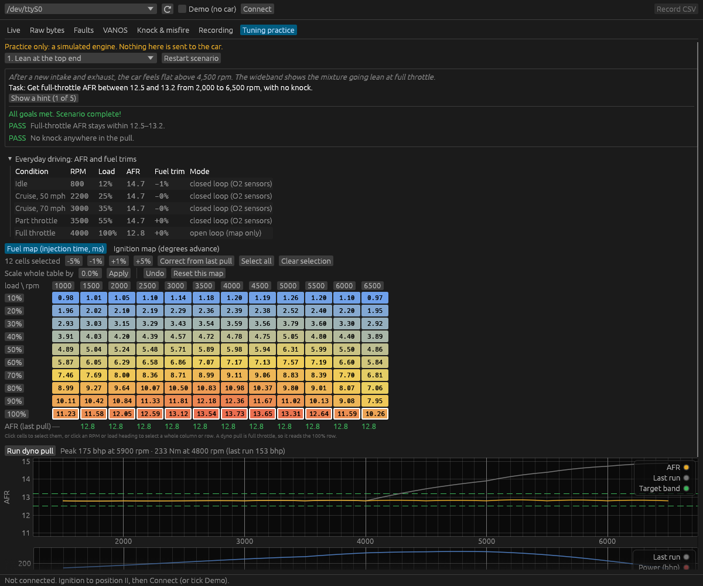
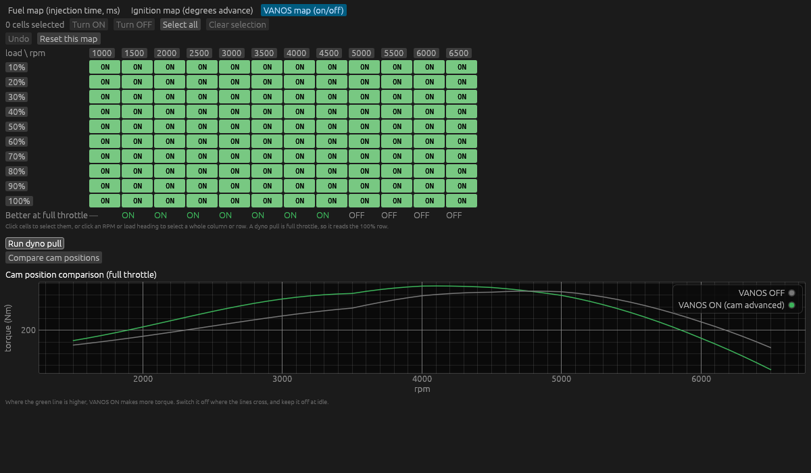

# e36-tuning-mac

Native macOS (Apple Silicon) tools for the BMW E36's **Siemens MS41** engine
ECU (DME), for M52/S52 engines. No Windows or VM needed.

**Current stage: diagnostics and live data.** The tools can read the ECU's
identity, show live data, and read and clear fault codes. Nothing here writes
to the ECU's flash yet. See [docs/PLAN.md](docs/PLAN.md) for where this is heading
(logging, map editing, flashing).

## Install (on the Mac)

```sh
# Apple's command line tools (Rust needs their linker); skip if already installed
xcode-select --install

# Install Rust once (official installer, from https://rust-lang.org/tools/install)
curl --proto '=https' --tlsv1.2 -sSf https://sh.rustup.rs | sh

git clone https://github.com/3wperor/e36-tuning-mac
cd e36-tuning-mac
cargo build --release
```

The program is `target/release/e36`.

## Live app


```sh
cargo run --release -p e36-app            # connect to the car
cargo run --release -p e36-app -- --demo  # try it with a simulated ECU, no cable needed
cargo run --release -p e36-app -- --demo --noisy  # simulated ECU on a noisy line, like a running engine
```

Next to the read rate, **link %** shows how many requests got a good reply.
The tools pace themselves, retry errors and reconnect on their own; see
[Logging with the engine running](docs/HARDWARE.md#logging-with-the-engine-running).

- **Live**: engine speed, intake and coolant temperature and ignition timing,
  shown as gauges plus a 60-second chart. **These decoded values are not yet
  verified for your ECU**; see below.
- **Raw bytes**: every byte of the live data block. Bytes light up when they
  change, so you can rev the engine and see which byte is RPM.
- **Faults**: read the stored fault codes with plain-English descriptions,
  and clear them with a confirmation step. The raw bytes are always shown
  too, because the reply layout is still unverified for your ECU.
- **VANOS**: big ON/OFF indicator, a timeline against engine speed, and a
  log of every switch with the RPM it happened at. The first time, use the
  bit finder in the same tab: drive or rev so VANOS switches, spot the bit
  that flips each time, and click it. The app remembers it.
- **Knock & misfire**: the ECU's global knock retard over time against
  engine speed (raw values for now, units still to be calibrated), a
  per-cylinder misfire and knock-sensor status, and a log of fault codes
  that appear or clear while you drive. The fault memory is re-checked
  every 15 s. A Euro MS41.0 may not detect misfires at all; see the note in
  the tab.
- **Recording**: tick the values you want in your logs. The app remembers
  your choice.
- **Record CSV** saves a log to `~/Documents/e36-logs/`. It opens in Numbers,
  Excel or MegaLogViewer.

## Tuning practice



The **Tuning practice** tab is a simulated M52 engine for learning to tune
without risking the real one. It never talks to the car and works without a
cable. Edit the fuel and ignition maps, run a simulated dyno pull, and see AFR,
power, torque and knock against RPM, with your previous run shown for
comparison. Scenarios, each with a task, hints and pass/fail checks:

1. **Lean at the top end**: correct fuel from wideband readings
   (new fuel = old × measured AFR / target), and see lean mixtures knock.
2. **Too much timing**: remove knock without throwing away power.
3. **Vacuum leak**: read fuel trims, pick the right fix, then simulate the repair.
4. **Bigger injectors**: scale a whole table.
5. **VANOS switch points**: edit the VANOS on/off map, and use "Compare cam
   positions" (one pull with VANOS always on, one always off) to see where the
   advanced cam helps and where to switch it off. VANOS on at idle makes it lumpy.
6. **ITB conversion**: a runner length slider for pulse tuning (shorter runners
   move the torque peak up the revs), and why ITBs, which fuel from throttle
   position instead of an air flow meter, need the fuel map retuned whenever
   breathing changes.
7. **Cams and trumpets**: on an ITB engine with fixed runners, choose trumpet
   length (it adds to the runner, so it moves the tuned RPM), the bellmouth
   shape (a plain pipe loses flow), and cam duration (more top end, less
   low-down torque, and a lumpy idle if you go too far).
8. **Free practice**: a healthy engine where every part can be changed:
   standard intake or ITBs, runners, trumpets and cams.



The engine model is simplified but behaves the right way round; its numbers
are plausible for an M52B25, not measurements of one.

Why "unverified": the request for live data (`12 05 0B 03 1F`) is well
documented, but where each value sits in the reply, and how it is scaled, only
comes from forum code. It also differs between MS41 versions. A short
recording from your car will settle it.

## Command line

Hook up the cable as described in [docs/HARDWARE.md](docs/HARDWARE.md), then
turn the ignition to position II with the engine off.

```sh
./target/release/e36 ports                   # find the cable
./target/release/e36 ident --trace           # DME part number + raw bytes
./target/release/e36 faults --trace          # stored fault codes, translated
./target/release/e36 live --raw              # live data in the terminal
./target/release/e36 clear-faults            # shows faults, asks, then erases
```

The port is detected automatically when only one USB serial cable is plugged
in. Otherwise pass `--port /dev/cu.usbserial-XXXX` or set `E36_PORT`.

Add `--demo` to any command to talk to the simulated ECU instead.

Keep the `--trace` output from the first runs on the car. Those bytes are what
fault-code decoding and the next stages get built and tested against.

## Layout

```
crates/ds2   BMW DS2 protocol library: frames, echo handling, MS41 commands,
             serial cable, and a mock ECU for tests
crates/e36   the `e36` command-line tool
crates/e36-app  the live data app (egui, native window)
docs/        plan and hardware notes
```

`cargo test` runs the whole protocol test suite against the mock ECU; no car
is needed.
