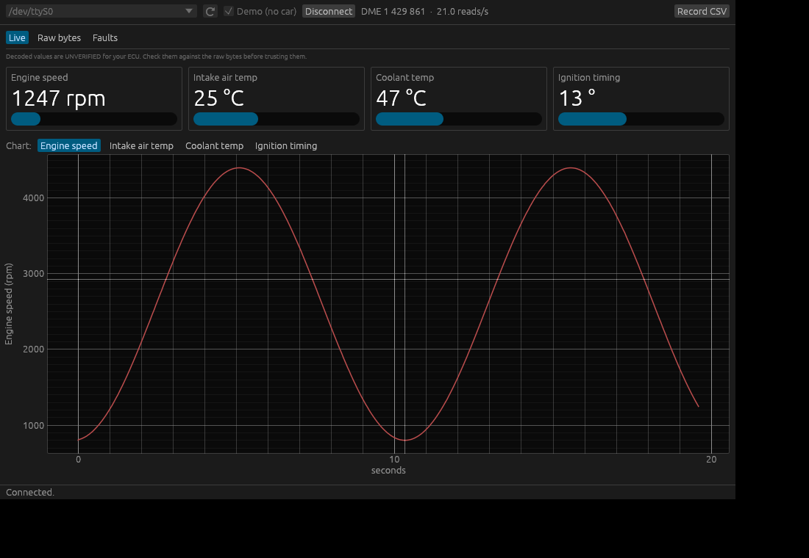

# e36-tuning-mac

Native macOS (Apple Silicon) tools for the BMW E36's **Siemens MS41** engine
ECU (DME), for M52/S52 engines. No Windows or VM needed.

**Current stage: diagnostics and live data.** The tools can read the ECU's
identity, show live data, and read and clear fault codes. Nothing here writes
to the ECU's flash yet. See [docs/PLAN.md](docs/PLAN.md) for where this is heading
(logging, map editing, flashing).

## Install (on the Mac)

```sh
# Apple's command line tools (Rust needs their linker); skip if already installed
xcode-select --install

# Install Rust once (official installer, from https://rust-lang.org/tools/install)
curl --proto '=https' --tlsv1.2 -sSf https://sh.rustup.rs | sh

git clone https://github.com/3wperor/e36-tuning-mac
cd e36-tuning-mac
cargo build --release
```

The program is `target/release/e36`.

## Live app



```sh
cargo run --release -p e36-app            # connect to the car
cargo run --release -p e36-app -- --demo  # try it with a simulated ECU, no cable needed
```

- **Live**: engine speed, intake and coolant temperature and ignition timing,
  shown as gauges plus a 60-second chart. **These decoded values are not yet
  verified for your ECU**; see below.
- **Raw bytes**: every byte of the live data block. Bytes light up when they
  change, so you can rev the engine and see which byte is RPM.
- **Faults**: read the stored fault codes with plain-English descriptions,
  and clear them with a confirmation step. The raw bytes are always shown
  too, because the reply layout is still unverified for your ECU.
- **Recording**: tick the values you want in your logs. The app remembers
  your choice.
- **Record CSV** saves a log to `~/Documents/e36-logs/`. It opens in Numbers,
  Excel or MegaLogViewer.

Why "unverified": the request for live data (`12 05 0B 03 1F`) is well
documented, but where each value sits in the reply, and how it is scaled, only
comes from forum code. It also differs between MS41 versions. A short
recording from your car will settle it.

## Command line

Hook up the cable as described in [docs/HARDWARE.md](docs/HARDWARE.md), then
turn the ignition to position II with the engine off.

```sh
./target/release/e36 ports                   # find the cable
./target/release/e36 ident --trace           # DME part number + raw bytes
./target/release/e36 faults --trace          # stored fault codes, translated
./target/release/e36 live --raw              # live data in the terminal
./target/release/e36 clear-faults            # shows faults, asks, then erases
```

The port is detected automatically when only one USB serial cable is plugged
in. Otherwise pass `--port /dev/cu.usbserial-XXXX` or set `E36_PORT`.

Add `--demo` to any command to talk to the simulated ECU instead.

Keep the `--trace` output from the first runs on the car. Those bytes are what
fault-code decoding and the next stages get built and tested against.

## Layout

```
crates/ds2   BMW DS2 protocol library: frames, echo handling, MS41 commands,
             serial cable, and a mock ECU for tests
crates/e36   the `e36` command-line tool
crates/e36-app  the live data app (egui, native window)
docs/        plan and hardware notes
```

`cargo test` runs the whole protocol test suite against the mock ECU; no car
is needed.
